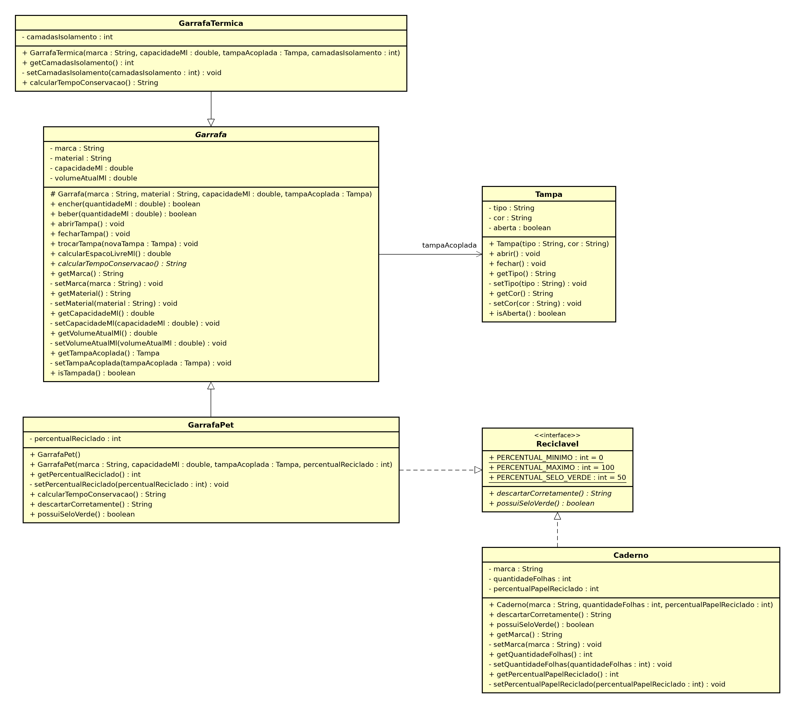
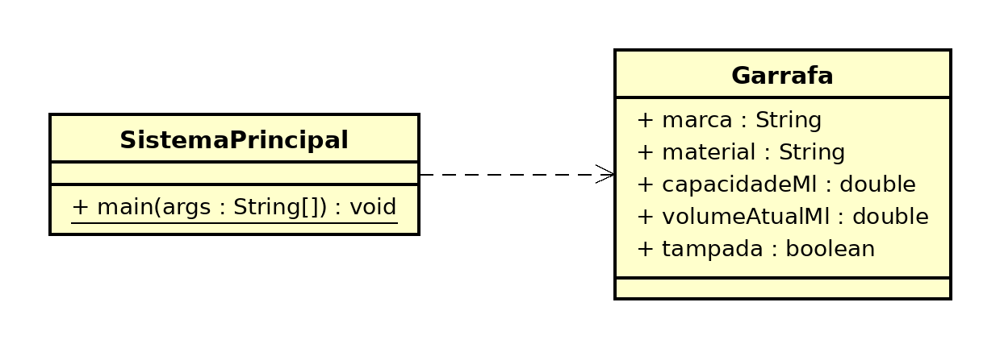
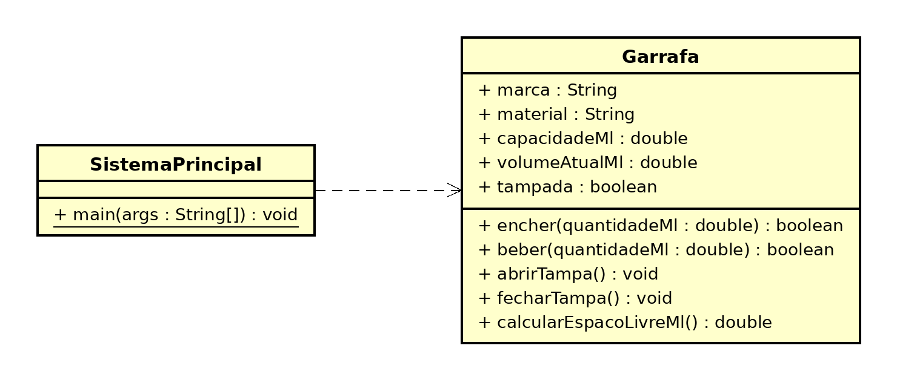
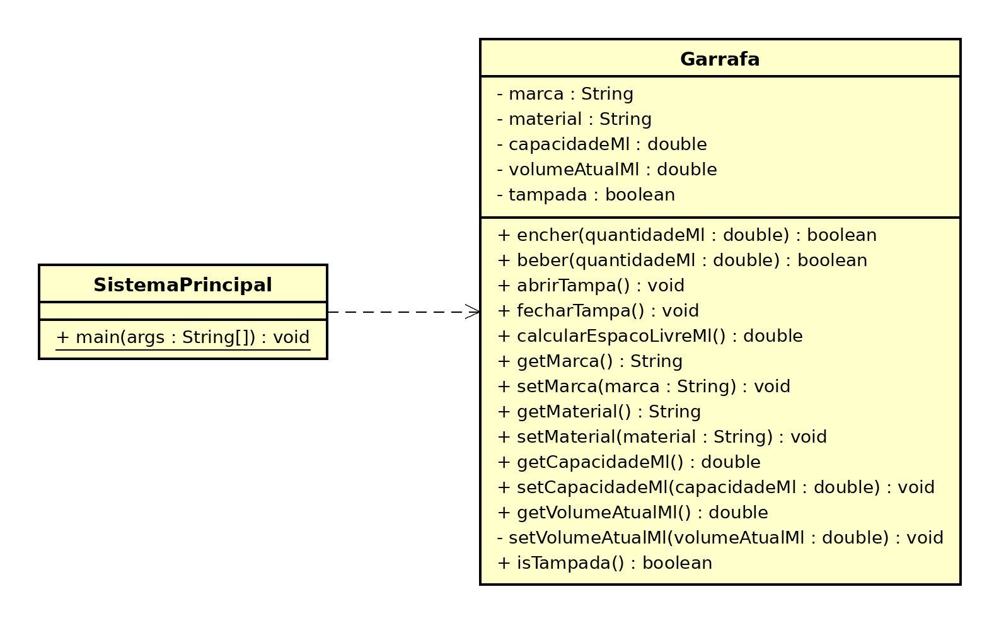
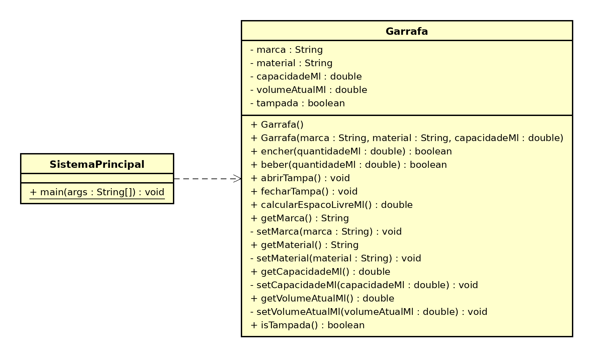
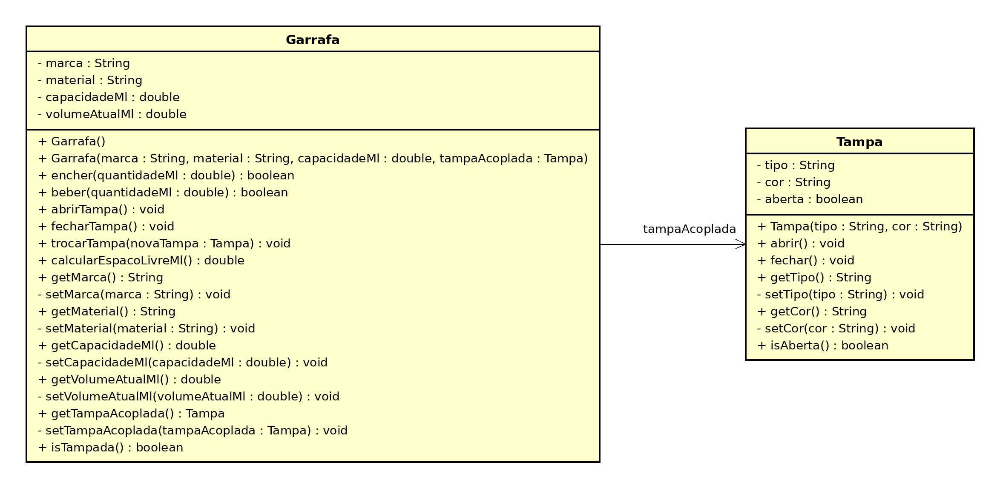
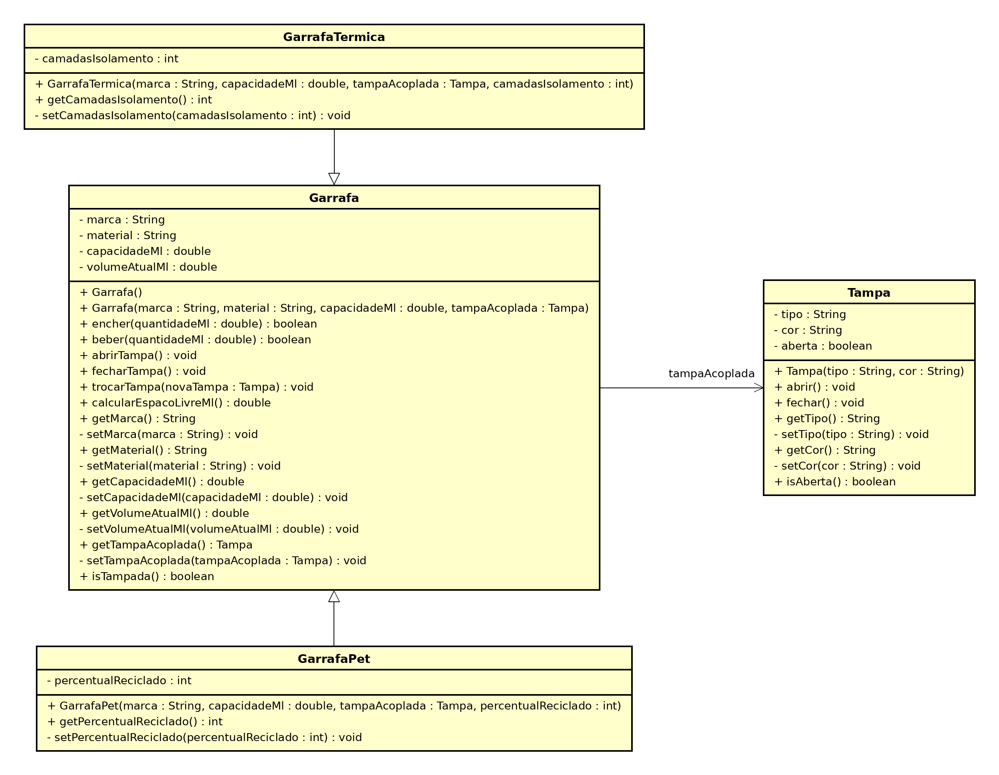
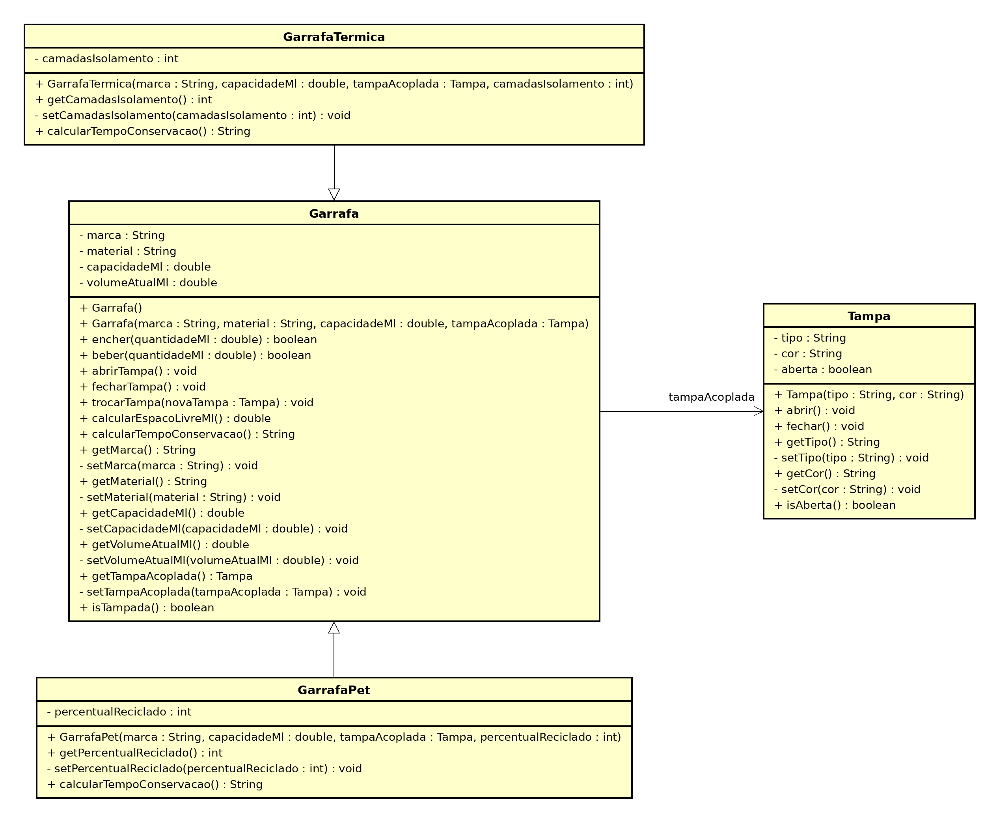
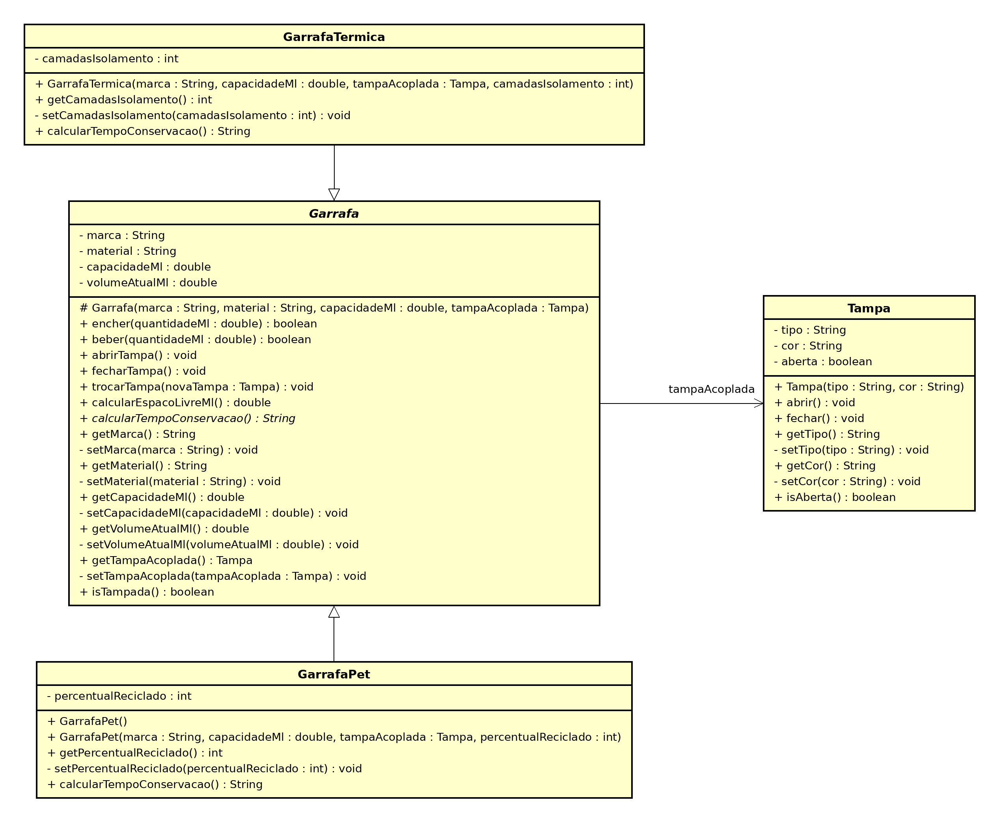

# Projeto Garrafas (FiapRide) - Nícolas Borges Natal

## 📊 Informações do Aluno

- **Nome:** Nícolas Borges Natal
- **RM:** 568230
- **Turma:** 2CCPR
- **Curso:** Ciência da Computação
- **GitHub:** [@nicolasborgesnatal](https://github.com/nicolasborgesnatal)

---

## 🎯 Descrição do Projeto

Este projeto é o resultado do aprendizado nas aulas 1-9 de Programação Orientada a Objetos, onde desenvolvemos o sistema de **Garrafas**, meu projeto pessoal aplicando os mesmos conceitos que o professor construiu no FiapRide.

O sistema modela garrafas do mundo real: elas são fabricadas com marca, material e capacidade fixos, possuem uma tampa que abre e fecha, podem ser enchidas e esvaziadas sem nunca transbordar ou ficar com volume negativo, e cada tipo conserva a temperatura da bebida de um jeito diferente. Na última aula, o sistema ganhou a capacidade de reciclagem, compartilhada entre a garrafa PET e um caderno, que não têm nenhum parentesco entre si.

### Estrutura do repositório

```
poo-nicolas-borges-natal/
├── diagramas/                     # Diagramas UML de cada aula
├── src/
│   └── br/com/garrafa/
│       ├── main/
│       │   └── SistemaPrincipal.java
│       └── model/
│           ├── Garrafa.java           # Classe abstrata (mãe)
│           ├── GarrafaTermica.java    # Filha
│           ├── GarrafaPet.java        # Filha + Reciclavel
│           ├── Tampa.java             # Associada à Garrafa
│           ├── Reciclavel.java        # Interface
│           └── Caderno.java           # Reciclavel fora da hierarquia
├── README.md
└── .gitignore
```

### Como executar

1. Importe o projeto no Eclipse (File → Import → Existing Projects into Workspace).
2. Abra `src/br/com/garrafa/main/SistemaPrincipal.java`.
3. Execute com Run As → Java Application (ou `Ctrl + F11`).

---

## ✅ Checklist de Implementação

- [x] Aula 1 - Classes e Objetos
- [x] Aula 2 - Métodos
- [x] Aula 3 - Encapsulamento
- [x] Aula 4 - Construtores
- [x] Aula 5 - Associação
- [x] Aula 6 - Herança
- [x] Aula 7 - Polimorfismo
- [x] Aula 8 - Classes Abstratas
- [x] Aula 9 - Interfaces

---

## 🤔 Perguntas de Reflexão

### Aula 1 - Classes e Objetos

**Pergunta:** "Por que precisamos criar uma classe `Passageiro`? Não seria mais fácil apenas criar variáveis soltas no main, como `String nomeAna = "Ana"` e `double saldoAna = 50.0`?

**Pense:** E se o FiapRide tiver 1 milhão de usuários? Como a Classe ajuda a resolver isso?"

**Sua Resposta:**
Com variáveis soltas, cada usuário novo exigiria declarar mais variáveis à mão (`nomeAna`, `saldoAna`, `nomeCarlos`, `saldoCarlos`...), e com 1 milhão de usuários isso simplesmente não existe como código. Além disso, nada garante que o nome e o saldo da Ana andem juntos: são duas variáveis independentes que eu mesmo teria que manter sincronizadas.

A classe resolve isso porque é um molde: eu descrevo uma única vez o que todo passageiro tem, e o `new` cria quantos objetos forem necessários, cada um com seu próprio estado agrupado. Aí 1 milhão de usuários vira uma lista de objetos, não 2 milhões de variáveis.

Vi isso na prática na Garrafa: com o mesmo molde criei a minha Stanley e a "garrafa do professor", e mudar o volume de uma não afetava a outra, porque cada objeto ocupa seu próprio espaço na memória.

---

### Aula 2 - Métodos

**Pergunta:** "Se nós podemos simplesmente fazer `passageiro.saldo = passageiro.saldo + 100` diretamente no código principal, por que dá tanto trabalho criar um método específico chamado `adicionarSaldo(valor)` para fazer isso? Quais seriam os riscos para a nossa startup de mobilidade se deixássemos qualquer programador alterar o saldo diretamente?"

**Sua Resposta:**
O método concentra a regra de negócio em um único lugar. Se qualquer programador puder fazer `saldo = saldo + valor` direto, nada impede uma recarga negativa, uma viagem paga sem saldo ou até alguém "dando" saldo para si mesmo. Para uma startup de mobilidade, isso é prejuízo financeiro e fraude.

Outro risco é a regra ficar espalhada: se cada parte do sistema validar o saldo do seu jeito, basta um lugar esquecer o `if` para o sistema inteiro ficar inconsistente. Com o método, a validação está escrita uma vez só.

Na Garrafa, o `encher()` impede transbordar e encher com a tampa fechada, e o `beber()` impede beber mais do que tem. Mas preciso ser sincero: na Aula 2 os atributos ainda eram `public`, então o método sozinho não protegia nada, porque qualquer um ainda podia escrever `volumeAtualMl = 999999` no main. Só entendi a importância completa disso na aula seguinte.

---

### Aula 3 - Encapsulamento

**Pergunta:** "No nosso código, os atributos são `private`, mas os métodos `getSaldo()` e `getNome()` são `public`. Por que é seguro deixar o `get` público, mas perigoso deixar o atributo original público?

Pense bem: Qual a diferença entre dar a alguém uma CÓPIA de um documento seu, e entregar o documento ORIGINAL para a pessoa rasurar?"

**Sua Resposta:**
O `get` entrega uma cópia do valor: quem chama `getSaldo()` recebe um número e pode fazer o que quiser com ele, mas o saldo guardado dentro do objeto continua intacto. Já o atributo público é o documento original: qualquer classe pode rasurar, e o objeto nem fica sabendo.

Com o atributo `private`, toda alteração precisa passar por um método da própria classe, que valida antes. Na Garrafa, o `getVolumeAtualMl()` é público, mas o `setVolumeAtualMl()` é privado: o volume só muda por `encher()` e `beber()`.

Um ponto que percebi depois: essa analogia da cópia vale perfeitamente para primitivos e `String`, mas não para objetos. O `getTampaAcoplada()` devolve a referência da tampa real, então quem recebe consegue chamar `fechar()` nela. Isso apareceu no meu teste de passagem por referência da Aula 5. Ou seja, encapsular objetos associados exige mais cuidado do que encapsular um `double`.

---

### Aula 4 - Construtores

**Pergunta:** "Na nossa classe `Veiculo`, nós tomamos duas decisões arquitetônicas muito importantes:

1. Nós **não** criamos o método `setModelo()`.
2. O `setPlaca()` foi criado como **privado**, e criamos um método público chamado `atualizarPlaca()` para acessá-lo.

Pensando no mundo real e no Clean Code: Por que é um erro gravíssimo clicar em 'Gerar Getters e Setters para tudo' automaticamente na sua IDE? Como as nossas duas decisões acima protegem o sistema de fraudes e falhas de lógica?"

**Sua Resposta:**
Gerar setters para tudo cria portas para mudanças que não existem no mundo real. Um Fiat Uno não vira Corolla, então um `setModelo()` público só serve para permitir uma fraude ou um bug. E a placa até pode mudar, mas não é "alterar um dado no banco": é um processo no Detran. Por isso o `atualizarPlaca()` tem nome de processo, e o `setPlaca()` privado fica só como a engrenagem de validação.

Eu cometi exatamente esse erro e corrigi: na Aula 3, como ainda não tinha construtor, deixei `setMarca()`, `setMaterial()` e `setCapacidadeMl()` públicos, que eram o único jeito de configurar a garrafa. Na Aula 4, com o construtor exigindo esses dados no nascimento, percebi que nenhum deles muda depois que a garrafa sai da fábrica e transformei os três em `private`. Eles continuam existindo só para validar dentro do construtor.

O equivalente ao `atualizarPlaca()` no meu projeto é o `trocarTampa()`: trocar uma tampa perdida é uma ação real, então ela é pública, mas o `setTampaAcoplada()` que valida é privado.

---

### Aula 5 - Associação

**Pergunta:** "No construtor da `Viagem`, nós exigimos o objeto inteiro (`Passageiro solicitante`). Se o nosso resumo só precisa imprimir o nome da pessoa, não seria mais fácil e mais leve pedir apenas a String do nome no construtor da Viagem (`String nomeDoPassageiro`) em vez do objeto todo?

Pense nas regras de negócio: O que acontece na hora que a Viagem acaba e o sistema precisa descontar o saldo? Se a Viagem tiver apenas a String "Ana Silva", ela consegue mexer no dinheiro dela?"

**Sua Resposta:**
Com apenas a `String`, a Viagem sabe o nome da Ana, mas não tem acesso a ela. Na hora de cobrar, não teria como chamar `pagarViagem()`, porque um texto não tem saldo nem métodos. Guardando o objeto, a Viagem guarda uma referência para a Ana real e pode pedir para ela pagar, respeitando as regras que estão dentro do `Passageiro`. E nem é "mais pesado": o que fica dentro da Viagem é só a referência, não uma cópia do objeto.

Na Garrafa isso ficou muito claro. Se ela guardasse só a `String` "Rosca", não conseguiria abrir nem fechar a tampa. Por isso movi o estado aberta/fechada para dentro da `Tampa`, e a Garrafa só repassa o comando (`abrirTampa()` chama `tampaAcoplada.abrir()`).

No meu main, fechei a tampa direto pela variável `tampaRosca`, por fora da garrafa, e a garrafa enxergou a mudança na hora. É a mesma prova do saldo da Ana consultado através da Viagem: os dois apontam para o mesmo objeto na memória.

---

### Aula 6 - Herança

**Pergunta:** "No nosso código, a mãe `Veiculo` possui os atributos `placa` e `modelo` como `private`. Quando o `Carro` herda de `Veiculo`, ele recebe esses atributos, mas o código dentro de `Carro` NÃO consegue fazer `this.placa = "ABC"`. Ele é obrigado a usar o `super()` ou o `setPlaca()`.

Por que o Java não deixa a filha alterar as variáveis privadas da mãe diretamente? Qual o princípio das aulas passadas que isso está protegendo?"

**Sua Resposta:**
O princípio protegido é o encapsulamento. A mãe tem regras de validação, e se a filha pudesse escrever direto nos atributos privados, bastaria criar uma subclasse para furar todas as regras que construímos nas aulas 3 e 4. Herança dá acesso ao que a mãe oferece publicamente, não às entranhas dela.

Na Garrafa, a `GarrafaTermica` e a `GarrafaPet` passam marca, material e capacidade pelo `super()`, e quem valida é a mãe. Então a regra de capacidade entre 0 e 3000 ml vale para qualquer filha, existente ou futura, sem eu precisar repetir o `if` em cada uma.

Também aproveitei a herança para tirar uma responsabilidade do usuário: a térmica já passa "Aço inox" e a PET já passa "Plástico PET" para a mãe, porque o material faz parte do que define cada tipo.

---

### Aula 7 - Polimorfismo

**Pergunta:** "No nosso loop `for (Veiculo veiculo : frota)`, a variável `veiculo` é do tipo genérico `Veiculo`. Se esquecêssemos de criar o método `calcularAutonomia()` lá na classe mãe `Veiculo`, nós conseguiríamos chamá-lo dentro do loop, mesmo sabendo que ele existe dentro do `Carro` e da `Moto`? Por que o contrato precisa existir na base da hierarquia?"

**Sua Resposta:**
Não conseguiríamos. O compilador decide o que pode ser chamado olhando o tipo da variável, não o objeto que vai estar lá na execução. Para ele, `veiculo` é um `Veiculo`, e se `Veiculo` não tem `calcularAutonomia()`, a chamada nem compila, mesmo que todas as filhas tenham o método.

O contrato na base é a promessa de que todo objeto daquela hierarquia sabe responder àquele comando. Só com essa garantia o Java deixa chamar o método pelo tipo genérico, e aí, na execução, escolhe a versão da filha certa.

Na Garrafa, o `calcularTempoConservacao()` está na mãe, e a lista `List<Garrafa>` chama o mesmo método para térmicas e PETs com resultados diferentes. Sem o contrato na base, a única saída seria `if (garrafa instanceof GarrafaTermica)` com cast, que é exatamente o anti-padrão que a aula condenou.

---

### Aula 8 - Classes Abstratas

**Pergunta:** "Pense no mundo real: Faz sentido existir um objeto que é APENAS 'Veículo' sem ser um tipo específico? Você já entrou em uma concessionária e comprou "um veículo" genérico, sem ser carro, moto, caminhão ou nada disso?

Por que, então, no código, precisamos EXPLICITAMENTE dizer ao Java que `Veiculo` é `abstract`? Por que ele não deduz isso sozinho?

Pense: Se esquecermos de colocar `abstract`, qual o risco que corremos? Alguém pode criar `new Veiculo()` e quebrar a lógica do nosso sistema?"

**Sua Resposta:**
Não faz sentido no mundo real, mas o Java não tem como saber disso, porque é uma decisão de modelagem do negócio. Para o compilador, uma classe com construtor e métodos com corpo é instanciável. Só quem modela o domínio sabe que "veículo" é um conceito e não uma coisa, então precisamos declarar isso.

O risco de esquecer é real, e eu mesmo vivi: na Aula 7, minha `Garrafa` ainda era concreta, e coloquei uma `new Garrafa()` "Genérica" na prateleira. O resultado do relatório foi "Conservação não definida para uma garrafa genérica", ou seja, um objeto que existe no sistema mas não sabe responder às regras dele.

Na Aula 8, tornei a `Garrafa` abstrata e o `calcularTempoConservacao()` virou abstrato, então o compilador passou a obrigar toda filha a implementar. O construtor padrão saiu da mãe e foi para a `GarrafaPet()`, e agora até a garrafa "genérica" é uma PET de verdade.

---

### Aula 9 - Interfaces

**Pergunta:** "Por que Java permite herança simples (apenas uma mãe), mas múltipla implementação de interfaces (vários contratos)?

Pense: Se `CarroEletrico` pudesse herdar de `Veiculo` E de `Bateria` ao mesmo tempo (herança múltipla), o que aconteceria se AMBAS as mães tivessem um método chamado `ligar()`?

Como as interfaces resolvem esse problema?"

**Sua Resposta:**
Se as duas mães tivessem `ligar()` com implementações diferentes, o `CarroEletrico` herdaria dois códigos para o mesmo método e o Java não teria como saber qual executar. Esse é o problema do diamante, e o Java evita ele proibindo mais de uma mãe.

Interfaces não têm esse problema porque definem só a assinatura, sem código. Se duas interfaces exigirem `ligar()`, a classe implementa uma vez e satisfaz as duas, porque a implementação é dela, não herdada de ninguém. (Desde o Java 8 existem métodos `default` em interfaces, mas mesmo nesse caso, se houver conflito, o Java obriga a classe a sobrescrever e decidir explicitamente.)

No meu projeto, a `GarrafaPet` herda de `Garrafa` e também implementa `Reciclavel`, enquanto o `Caderno` implementa `Reciclavel` sem ter nada a ver com garrafas. Os dois entram no mesmo array `Reciclavel[]` e respondem ao `descartarCorretamente()` cada um do seu jeito: o que os une é a capacidade, não o parentesco.

---

## 🚀 Desafios Técnicos Implementados

### Desafio Pessoal (Seu Projeto)

**Qual foi o domínio que você escolheu para seu projeto pessoal?**
Sistema de Garrafas: garrafas térmicas e PET, com tampa, controle de volume, tempo de conservação da bebida e descarte reciclável.

**Quais classes você criou?**
`Garrafa` (abstrata), `GarrafaTermica`, `GarrafaPet`, `Tampa`, `Reciclavel` (interface), `Caderno` e `SistemaPrincipal`.

**Qual foi o maior desafio técnico que você enfrentou?**
O maior desafio foi a Aula 5, quando a `Tampa` entrou no projeto. A primeira ideia era só adicionar a tampa como um atributo a mais e manter o `boolean tampada` dentro da `Garrafa`. Mas aí existiriam duas fontes de verdade: a garrafa dizendo que estava fechada e a tampa sem saber de nada. Fazia a associação existir no código, mas sem nenhum propósito real.

A solução foi perguntar quem, no mundo real, sabe se está aberto ou fechado: é a tampa. Então movi o estado `aberta` e os métodos `abrir()` e `fechar()` para a `Tampa`, removi o atributo `tampada` da `Garrafa` e fiz ela delegar: `abrirTampa()` só chama `tampaAcoplada.abrir()`, e `isTampada()` pergunta para a tampa.

Isso teve consequências que precisei tratar. O `encher()` e o `beber()` passaram a consultar a tampa. A tampa passou a nascer fechada, então os testes precisaram abri-la antes de encher. E como agora a garrafa depende da tampa para funcionar, o `setTampaAcoplada()` precisou bloquear `null`, e criei o `trocarTampa()` para a troca acontecer como um processo validado.

O teste que confirmou que a decisão estava certa foi fechar a tampa por fora da garrafa e ver a garrafa enxergar a mudança. Foi ali que entendi de verdade a diferença entre guardar um dado e guardar uma referência para outro objeto.

---

## 🗺️ Diagramas UML

Diagrama final (Aula 9):



<details>
<summary>Evolução do diagrama, aula por aula</summary>

**Aula 1 - Classes e Objetos**


**Aula 2 - Métodos**


**Aula 3 - Encapsulamento**


**Aula 4 - Construtores**


**Aula 5 - Associação**


**Aula 6 - Herança**


**Aula 7 - Polimorfismo**


**Aula 8 - Classes Abstratas**


</details>

---

## 🎓 Conclusão

**O que você aprendeu nestas 9 aulas?**
Aprendi que orientação a objetos é muito mais sobre decisões do que sobre sintaxe. Escrever `extends`, `private` ou `abstract` é fácil; difícil é saber onde cada coisa deve morar e quem deve ter permissão de mudar o quê. A Garrafa começou como um punhado de atributos públicos preenchidos no main e terminou como uma hierarquia que se protege sozinha: nasce válida pelo construtor, só muda por métodos com nome de ação real, delega para a tampa o que é da tampa e obriga cada tipo a dizer como conserva a bebida. Também percebi que cada aula corrigia uma fraqueza da anterior: os métodos da Aula 2 só passaram a proteger de verdade com o `private` da Aula 3, e os setters públicos da Aula 3 só fizeram sentido fechar depois do construtor da Aula 4.

**Qual conceito foi mais difícil de entender?**
Decidir quando um setter deve existir. Eu achava que encapsulamento era "atributo privado com get e set", e na Aula 3 criei setters públicos para quase tudo. Só na Aula 4, pensando no que muda fisicamente em uma garrafa, entendi que marca, material e capacidade não mudam depois da fabricação, e que o volume só muda bebendo ou enchendo. Superei isso mudando a pergunta: em vez de "esse atributo precisa de setter?", passei a perguntar "que ação do mundo real altera isso?". Quando não existe ação, não existe setter público.

**O que você melhoraria no seu projeto se pudesse refazer?**
- **Construtores com 4 parâmetros.** As filhas recebem marca, capacidade, tampa e o atributo exclusivo, um a mais que o limite de 3 recomendado pelo Uncle Bob. Eu usaria o padrão Builder, citado na Aula 4.
- **Validação com mensagens em vez de exceções.** Quando um dado é inválido, o setter imprime um erro, mas o objeto é criado mesmo assim (o caderno com 150% reciclado nasce com 0%). O correto seria lançar `IllegalArgumentException` e impedir o objeto de nascer inválido.
- **Números mágicos.** O limite de 3000 ml e as 6 horas por camada de isolamento deveriam virar constantes nomeadas, como fiz com os percentuais na interface `Reciclavel`.
- **A térmica também é reciclável.** Aço inox é metal reciclável, então a `GarrafaTermica` poderia implementar `Reciclavel` com descarte no coletor amarelo.
- **Testes automatizados.** Hoje os testes são prints no `main`; com JUnit, cada regra (não transbordar, não beber com a tampa fechada, capacidade máxima) seria verificada automaticamente a cada mudança.